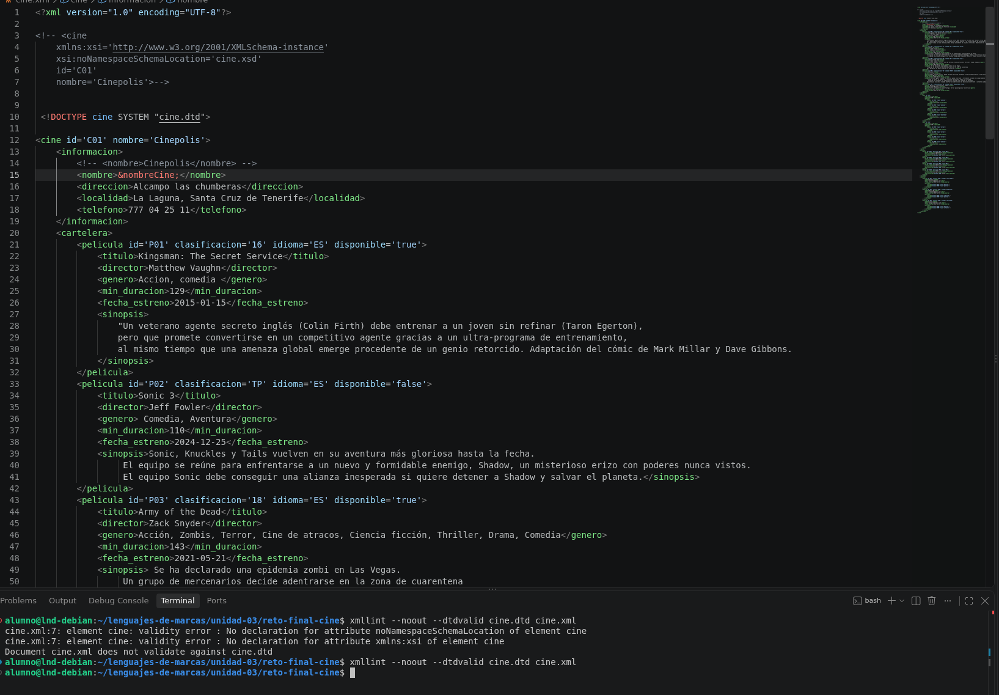
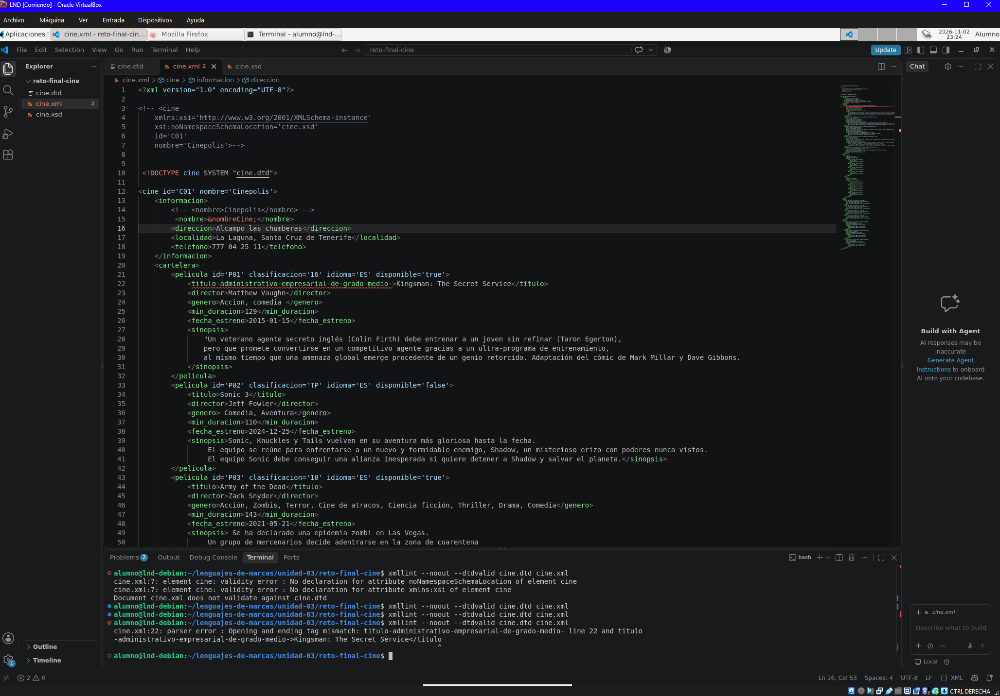
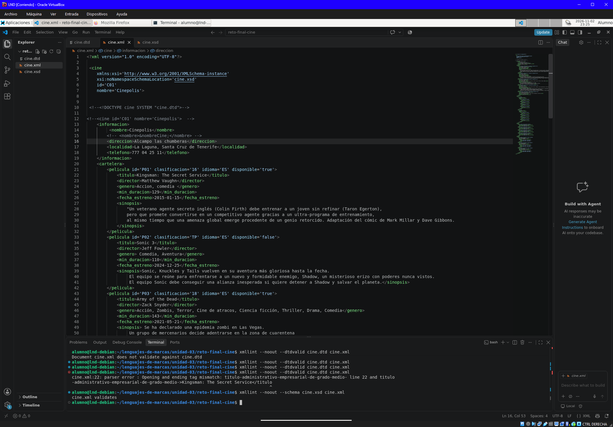
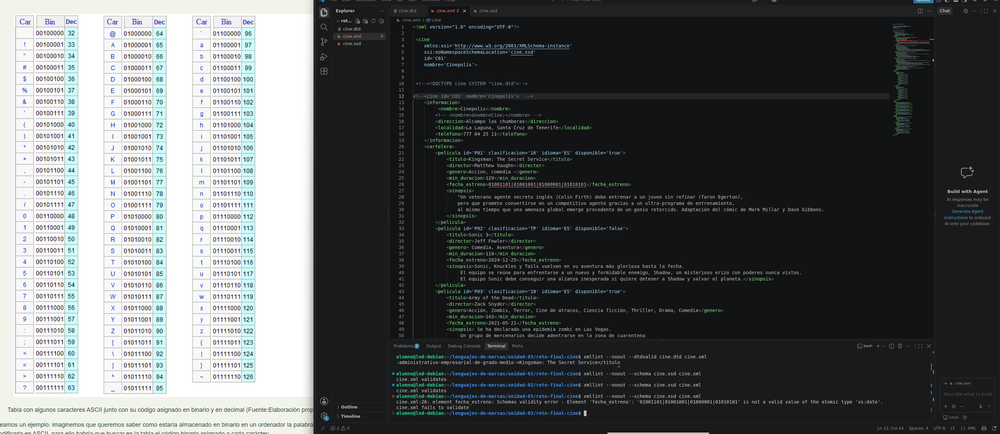

# Reto final de la unidad: Gestión de un cine

## Una breve presentación del proyecto.

El cine Cinépolis quiere organizar digitalmente su cartelera y sus reservas. Para ello, necesita registrar las películas que ofrece, las salas con sus butacas, las sesiones programadas y las entradas reservadas por los clientes.

Tu misión es crear los archivos cine.xml, cine.dtd y cine.xsd, de forma que el mismo XML sea válido tanto con el DTD como con el XSD.

No se proporciona código de partida: deberás decidir cómo organizar los elementos y atributos respetando los requisitos siguientes.

## Una explicación de la organización del XML y de las referencias entre elementos.

1. tenemos la declaracion del xml
2. elemento raiz
3. informacion que dentro lleva(nombre, direccion, localidad, telefono)
4. luego tenemos cartelera que tiene(pelicula)
5. y peliculas tiene(titulo, director, genero, min duracion, fecha estreno, sinopsis) con atributos(id, clasificacion, idioma y disponibilidad) y son 5 pelis
6. tenemos salas que tiene (sala) y esta ultima tiene (num de sala, capacidad, butacas) con atributo(id) 
7. butacas tiene (butaca) y esta ultima tiene (numero de asiento,fila,) atributos(premium,normal,adaptada) son 8 butacas entre las dos salas que hay 
8. siguiente tenemos sesiones, sesiones tiene (sesion) y esta ultima tiene (fecha de proyeccion, hora de inicio, precio de entrada(este tiene un atributo que es moneda)) con atributos(id,pelicula,sala) y hay 4 sesiones
9. reservas,reservas tiene (reserva) y reserva contiene(nombre, email,fecha de reserva, entradas(que este dentro tiene entrada con atributos butaca y tipo)) y hay 3 reservas

## Los comandos utilizados en las validaciones.

- El comando para  el DTD es :

```sh
xmllint --noout --dtdvalid cine.dtd cine.xml
```

- despues el comando para el XSD es :

```sh
xmllint --noout --schema cine.xsd cine.xml
```

## Las cuatro capturas con una explicación de qué demuestra cada una.


en la primera imagen se ve la terminal sin ningun error ya que la validacion funciono.



en esta segunda imagen se aprecia el fallo en titulo al tener como el mismo titulo-administrativo-empresarial-de-grado-medio.




en la tercera imagen se ve la terminal suelta un mensaje de que la validacion funciono.



y para rematar con la cuarta foto tenemos el error en la fecha ya que en vez de en el formato que puse inserte 0 y unos 1.

 <!--tiene sorpresa,jeje -->

## Una reflexión breve sobre las diferencias entre DTD y XSD observadas durante el trabajo.

Yo diria que xsd es mas recto e inflexible mientras que el dtd es mas libre a la par que menos estricto.
pd:el xsd es el demonio de hacer y el dtd es un camino de rosas.